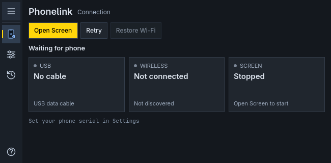

# Phonelink Android — scrcpy for Omarchy



**Android screen mirroring (screen copy) for Omarchy, using scrcpy over USB debugging
or wireless debugging.** Phonelink adds a tray app, a compact connection panel,
reconnect controls, crash recovery, and persistent phone and connection history.
It includes a native Omarchy bar plugin as well as the standalone tray app.
It is designed and tested on Omarchy / Hyprland. Other Hyprland desktops may work
when they provide the dependencies and session integration described below.

Find **Phonelink (scrcpy)** in the Omarchy application launcher with **Super + Space**.
Type `scr`, `scrcpy`, or `phonelink`. The phone icon in the tray opens the same panel.
The sidebar expands with its menu button or **Ctrl+B**. Actions stay above the
scrolling content; the three status tiles wrap as the window narrows.
Closing the panel hides it while the service keeps running. The mirrored Android
screen is a separate scrcpy window.

## Native Omarchy plugin

The plugin is a bar widget that uses the existing Phonelink backend. It is not a
second connection manager. The minimum backend capability is pluginIntegration,
shipped with backend 0.0.2. Python 3 is required by the small IPC bridge.

Install or update the backend first using the source installation steps below.
For an existing per-user installation, stop phonelink.service before running the
installer. Keep the backend enabled at login if you want connection monitoring
without opening a window. Then install the native plugin:

```sh
omarchy plugin add https://github.com/LightCC/phonelink-android.git --enable
```

This command works after the native-plugin PR is merged into the default branch.
The current development branch is feat/4-omarchy-plugin; it can be checked out for
local validation or installed from a Git clone whose default branch is that branch.
The plugin manager does not build/install the compiled backend or system packages.
A missing, stopped or old backend is reported in the tooltip; a click can start an
already installed user service. Guided installation/update is tracked separately
in [issue #5](https://github.com/LightCC/phonelink-android/issues/5).

The phone icon shows waiting, connected and mirroring states. Left-click opens the
existing tiled status panel; right-click refreshes status. There is no second popup,
and the widget's shell open/summon route opens the same standalone panel. Close that
window normally to hide it. There is no native popup for Escape or the shell hide
route to dismiss.

```sh
omarchy plugin list --json
omarchy bar move io.github.lightcc.phonelink --section right --before omarchy.network
omarchy plugin update io.github.lightcc.phonelink --yes
omarchy plugin disable io.github.lightcc.phonelink
omarchy plugin enable io.github.lightcc.phonelink
omarchy plugin remove io.github.lightcc.phonelink --yes
```

The widget refreshes a small state summary every eight seconds. It renews a 25-second
runtime lease that temporarily makes the standalone tray item passive. If the widget
is disabled/removed, Python is unavailable, or the shell crashes, the lease expires
and the standalone tray returns within 25 seconds (plus its one-second check interval).
The service and phone data stay intact. Multiple monitor instances renew the same
lease; disabling one bar does not hide another monitor's live widget.

Disabling/removing the plugin does not disable or uninstall the separately installed
backend. To stop that backend, use systemctl --user disable --now phonelink.service.
The standalone app and generic tray continue to work without the native plugin.
No plugin action installs packages, requests sudo, runs ADB directly or rearranges
unrelated bar items. Backend errors, timeouts and unavailable setup are reported.

Validate a clean plugin checkout on Omarchy:

```sh
./bin/test-plugin
./bin/test
```

The plugin check validates manifest paths, runs isolated bridge tests and lints the
QML against the installed Omarchy shell imports. The temporary qs import alias used
for lint is outside the plugin directory. Plugin repositories must not contain
symlinks. Check the installed shell API when changing widget or lifecycle contracts.
The widget follows Omarchy theme sizing and language through host components; English
and Danish catalogs are supplied. No marketplace submission has been made.

## Compatibility: Omarchy and other Hyprland desktops

**Verified:** Arch-based Omarchy, Qt 6.12, Hyprland, its StatusNotifierItem tray,
systemd user services, and one authorized Samsung Android 17 phone over USB and Wi-Fi.
This is the tested environment, not a claim that every phone or desktop is supported.

**Expected, not yet verified:** other Linux / Hyprland installations with Qt 6.7 or
newer, the Qt modules below, ADB, scrcpy, a session D-Bus, a StatusNotifierItem-compatible
tray such as a configured Waybar tray, an application launcher that reads desktop entries,
and a systemd user session connected to the graphical session. Hyprland alone does
not supply a tray or guarantee login-service integration.

The core connection manager does not require Omarchy commands. Omarchy theme and
language files are optional: without them, Phonelink falls back to a yellow accent
and English. Rounding follows Hyprland when available, otherwise it is zero.
Settings and state keep their `omarchy/phonelink` directory names on other desktops.
Other compositors, non-systemd systems, and non-Arch distributions are untested;
only the Arch package and the per-user source installer are currently supplied.

Qt 6.7 is the minimum because the source uses `QStandardPaths::StateLocation`.
See the [Qt documentation](https://doc.qt.io/qt-6/qstandardpaths.html).
For Hyprland session setup, see the official
[systemd guide](https://wiki.hypr.land/configuring/extra/systemd/) and
[UWSM guide](https://wiki.hypr.land/useful-utilities/uwsm/).

## Install on Omarchy

Install build and runtime dependencies on the target desktop:

```sh
omarchy pkg add base-devel qt6-base qt6-declarative qt6-svg qt6-wayland android-tools scrcpy python desktop-file-utils
```

The app uses Qt Core, GUI, D-Bus, Network, QML, Quick, Quick Controls, SVG and Wayland.
`qmake6`, a C++17 compiler, `make`, and Qt Test are needed to build and test it.
Python is used by the per-user installer and fake-device tests.
Other distributions need equivalent packages and Qt 6.7 or newer; their package
names and setup have not been verified here.

Clone the repository with an account that has access, then build and test:

```sh
git clone https://github.com/LightCC/phonelink-android.git
cd phonelink-android
./bin/build
./bin/test
```

Choose one installation method. The per-user method is the current verified
installation on the development Omarchy desktop.

### Per-user installation, without sudo

```sh
./bin/install-user --no-build
```

Without `--no-build`, the installer builds first. It installs the binary at
`~/.local/lib/phonelink/phonelink`, commands under `~/.local/bin/`, the launcher at
`~/.local/share/applications/phonelink.desktop`, and phone icons under
`~/.local/share/icons/hicolor/scalable/apps/`. The service is installed at
`~/.config/systemd/user/phonelink.service` and enabled for graphical login.
The launcher, icons and service honor `XDG_DATA_HOME` and `XDG_CONFIG_HOME` when set.
This installation is not registered with pacman. Ensure `~/.local/bin` is on PATH
for terminal commands; Omarchy's launcher uses an absolute command path.

### System-wide Arch package

From the repository root:

```sh
./bin/install
```

This runs `makepkg -fsi`, installs the Arch package through pacman, reloads systemd,
and enables the user service. Package installation requires sudo authorization.
It installs the binary and launcher command under `/usr/bin/`, the desktop entry
under `/usr/share/applications/`, icons under `/usr/share/icons/hicolor/scalable/apps/`,
and the unit at `/usr/lib/systemd/user/phonelink.service`.
The PKGBUILD must be built from this source tree, not as a standalone downloaded file.

A per-user unit and launcher can override system-wide copies. When changing installation
methods, stop the service and remove the old method's Phonelink installation files first.
Preserve the settings and history folders. Do not install both methods and assume
that the system package has replaced the per-user version.

## Omarchy launcher, tray and login setup

Both installers already install a desktop entry named **Phonelink (scrcpy)** with
`scrcpy`, phone, Android and mirroring search keywords. No Omarchy menu extension,
start-menu edit, Hyprland window rule or special tile configuration is required.
The normal launcher reads this desktop entry. The tray icon can be inside the
collapsed tray drawer; expand the drawer if it is not immediately visible.

The launcher calls `phonelink-launch`, which starts `phonelink.service` and then
opens the existing status panel. The service owns the resident tray process.
A single or secondary tray activation opens the panel as well.

Verify login setup:

```sh
systemctl --user daemon-reload
systemctl --user enable --now phonelink.service
systemctl --user is-enabled phonelink.service
systemctl --user is-active phonelink.service
systemctl --user is-active graphical-session.target
```

If a per-user launcher is missing or stale, check its entry and refresh its database:

```sh
desktop-file-validate ~/.local/share/applications/phonelink.desktop
update-desktop-database ~/.local/share/applications
```

For a system package, validate `/usr/share/applications/phonelink.desktop` instead.
Inspect `systemctl --user cat phonelink.service` to check which installation is used.
Avoid reinstalling or restarting the entire Omarchy shell to fix a desktop-entry typo.

The service is enabled under `graphical-session.target` and requires a usable Wayland
session environment in the systemd user manager. On other Hyprland setups, use UWSM
or equivalent session integration that activates this target and provides the display
environment. Merely enabling the unit does not create that session integration.
If the target is inactive, follow the official Hyprland guides linked above before
claiming login startup works. A missing tray host also needs desktop/bar configuration.
Fresh-login behavior has not been tested on a non-Omarchy desktop.

## Connect an Android phone

Use a phone supported by your installed scrcpy version. Enable Developer options
and USB debugging on the phone, connect a USB **data** cable, unlock it, and approve
this computer's debugging key. `unauthorized` means approval is still needed.

```sh
adb devices -l
```

Copy the authorized phone's serial into **Phonelink → Settings → Phone serial** and
save it while mirroring is stopped. A wireless `IP:port` is optional; the app can discover
this phone's advertised wireless ADB service. Open **Connection → Open Screen**.
Automatic mode prefers verified wireless and can fall back to USB. USB-only and
wireless-only modes are available.

For wireless debugging, connect the phone and PC to the same Wi-Fi network and enable
**Developer options → Wireless debugging** on the phone. Modern wireless pairing is
available on Android 11 and newer; menus and permissions vary by device.
See [Android's ADB documentation](https://developer.android.com/tools/adb).

If the computer is not paired yet, use the phone's **Pair device with pairing code**
screen and pair interactively in a local terminal:

```sh
adb pair PHONE_IP:PAIRING_PORT
```

Enter the pairing code at the prompt. The pairing port is different from the connection
port on the main Wireless debugging screen. Connect with that main-screen port:

```sh
adb connect PHONE_IP:DEBUGGING_PORT
```

The connection port can change after wireless debugging or the phone restarts.
Phonelink can rediscover the advertised service; saved endpoints are checked against
the configured phone serial before mirroring. It never assumes an old port still works.

If wireless debugging stalls, connect authorized USB, stop mirroring, then choose
**Restore Wi-Fi**. This toggles modern wireless debugging off and on through USB.
**Open Screen** can also do this when its automatic USB restoration setting is enabled.
Android may still require an on-phone network approval or a new pairing operation.
The app preserves existing ADB keys and does not enable legacy `adb tcpip 5555`.
After the panel confirms wireless debugging is connected and the screen uses Wi-Fi,
the USB cable can be removed.

The app uses `/usr/bin/adb` and `/usr/bin/scrcpy` by default. Nonstandard installations
can set `PHONELINK_ADB` and `PHONELINK_SCRCPY` in the service environment to absolute
executable paths. This path override has not been tested on another distribution.

## Startup, recovery and updates

The tray service starts at graphical login after installation. **Show status panel
when Phonelink starts** and **Start phone mirroring when Phonelink starts** are separate
settings, both off by default. The tray can run with neither window open.
These settings also apply when the service is restarted. Close the panel to hide it;
close the scrcpy window to stop that screen session. Audio stays on the phone by default.

Connection checks run every five seconds. Failed endpoint connections wait twenty
seconds between attempts. A failed scrcpy process gets up to five total attempts,
with delays of 1, 2, 4 and 8 seconds. A healthy minute resets the count. Stop Screen
cancels pending retries. Normal screen closure does not trigger recovery. The tray
service itself uses systemd `Restart=on-failure`, with at most five starts per minute.
After a tray-process restart, the startup preferences govern which windows reopen.

Before updating a per-user installation, stop its running binary; replacing it in
place while it is executing can fail. From a clean source checkout:

```sh
systemctl --user stop phonelink.service
git pull --ff-only
./bin/install-user
```

For a system-package update, stop the service and run `./bin/install`, then start it
again if it was already enabled. Existing settings and history are kept. Open Screen
again if automatic mirroring is off. To disable login startup:

```sh
systemctl --user disable --now phonelink.service
```

## History and configuration

**History → Open History Folder** launches the file manager. The panel shows the latest
forty events from the current service session; full history stays on disk without
automatic deletion. The default folder is `~/.local/state/omarchy/phonelink/history/`.
Daily `YYYY-MM-DD.jsonl` files retain timestamps, connection changes, scrcpy output,
errors and retries. `phones.json` retains each known serial, manufacturer, model,
Android version, USB vendor/product identifier and verified USB or wireless target.
Wireless records include IP, port, and first/last-seen times. Previous endpoints remain
when a new one is found. Metadata changes preserve prior details in the event log.
Historical imports retain their source and do not claim a new live verification.

History is local to the desktop, not part of the source repository. It contains phone
and network identifiers, but no screen captures, messages, pairing codes or ADB private
keys. History directories and files have owner-only permissions. Back up this folder
if long-term retention matters. Settings default to `~/.config/omarchy/phonelink.conf`.
`XDG_STATE_HOME` and `XDG_CONFIG_HOME` change the corresponding base directories.

## Commands, diagnostics and shortcuts

```sh
phonelink status --json
phonelink start
phonelink stop
phonelink retry
phonelink restore-wireless
phonelink open
phonelink skill install --json
systemctl --user status phonelink.service
journalctl --user -u phonelink.service --no-pager -n 50
```

Status returns live JSON and saved phone profiles. Other commands return 0 when accepted
and 1 on an IPC error; inspect status for the asynchronous result. Start the service first.
The CLI does not need a display. The optional skill installer writes an agent guide to
`${CODEX_HOME:-~/.codex}/skills/phonelink/`. If pairing needs a secret, an assistant must
use its secure secret tool rather than requesting the code in chat.

| Key | Action |
|---|---|
| Space | Open or stop screen, from Connection page |
| Ctrl+R | Retry connection |
| Ctrl+B | Expand or collapse navigation |
| Q / Escape | Hide panel |
| ? | Show shortcuts |

## Development and verification

The app uses C++17, Qt Quick and qmake6. `bin/test` runs isolated settings and fake
ADB/scrcpy executables. It covers endpoint validation, wrong-phone rejection, persistent
phone details and endpoints, closure, retries, USB restoration, independent startup
settings, responsive layouts and sidebar interaction. Sixteen backend tests and ten bridge tests passed on the
verified Omarchy desktop. A real phone, tray host and login session still need manual
verification on each additional target environment.

See [AGENTS.md](AGENTS.md) for source-workspace, installation and launcher instructions
for coding agents, and [verification notes](docs/verification.md) for recorded checks.
MIT licensed, copyright (c) 2026 Michael Scott Leiter (@MikeLeiterDev). Theme and
translation support derive from Omacut and Monologue (MIT, David Heinemeier Hansson);
see [LICENSE](LICENSE) for both notices.


## Tray icon troubleshooting

The service exports embedded phone icon pixels through StatusNotifierItem, so its tray
icon does not depend on system icon directories or a tray host's icon-theme cache.
Per-user desktop entries use the installed SVG's absolute path; system packages use the
standard hicolor icon name. The tray category is SystemServices.

On Omarchy, pin the `phonelink` tray item to keep it outside the collapsed drawer. The
tray group's location is a desktop preference, not an application-enforced change.
To place that group beside the network indicator, use `omarchy bar move omarchy.tray
--section right --before omarchy.network`. Preserve existing pinned items when adding
Phonelink through the tray's pin controls. Other desktops use their own tray settings.
An open panel may also have an ordinary window/dock entry; closing it leaves the tray
service running and accessible.
